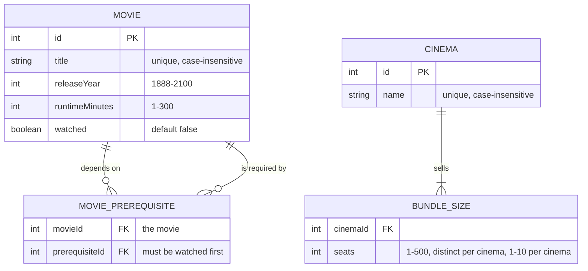

# Doomsday Ready

Plan your MCU rewatch before _Avengers: Doomsday_ and book an opening-night watch party.

- **Backend:** Node.js + Express (`/backend`), in-memory store with optional JSON-file persistence
- **Frontend:** React + Vite (`/frontend`), three views: Movies, Rewatch Plan, Booking
- **Hand-written logic (no libraries):** cycle detection and rewatch ordering (`backend/src/graph.js`), fewest-bundles booking (`backend/src/booking.js`)

## Run it

### Option 1: Docker Compose (one command)

```bash
docker compose up --build
```

- App: http://localhost:8081
- API: http://localhost:3000/api

Load the sample data from the brief (movies, links and four cinemas) once the stack is up:

```bash
docker compose exec backend node scripts/seed.js
```

### Option 2: Locally

```bash
# terminal 1: API on :3000
cd backend && npm install && npm start
# optional: load the sample data
npm run seed

# terminal 2: frontend on :5173 (proxies /api to :3000)
cd frontend && npm install && npm run dev
```

### Tests

```bash
cd backend && npm test
```

The tests cover every example in the brief (rewatch orders, the 409 circular case, all four booking examples), validation rules, rollback of failed updates, and a brute-force cross-check of the booking algorithm.

## Data model



Stored as JSON: a movie holds `prerequisites: number[]` (ids), a cinema holds `bundleSizes: number[]`. The movie graph must stay acyclic (a DAG).

## API (all under `/api`)

| Method & path                          | Purpose                                                                     |
| -------------------------------------- | --------------------------------------------------------------------------- |
| `POST /movies`                         | Create one movie (object) or several (array, all-or-nothing)                |
| `GET /movies`                          | List movies                                                                 |
| `GET /movies/:id`                      | Get one movie                                                               |
| `PATCH /movies/:id`                    | Update `title`, `releaseYear`, `runtimeMinutes`, `watched`, `prerequisites` |
| `GET /movies/:id/rewatch-order`        | Rewatch order for a target movie                                            |
| `POST /cinemas`                        | Create one cinema (object) or several (array)                               |
| `GET /cinemas`                         | List cinemas                                                                |
| `GET /cinemas/:id/booking?groupSize=6` | Booking quote                                                               |

Movie: `{ "id": 1, "title": "Iron Man", "releaseYear": 2008, "runtimeMinutes": 126, "prerequisites": [], "watched": false }`

Rewatch order response:

```json
{
  "target": { "id": 4, "title": "Captain America: Civil War" },
  "order": [
    {
      "id": 1,
      "title": "Iron Man",
      "releaseYear": 2008,
      "runtimeMinutes": 126,
      "watched": false
    }
  ],
  "totalCount": 3,
  "watchedCount": 0,
  "remainingRuntimeMinutes": 393
}
```

Booking response (`possible: false` gives `totalBundles: null`, `bundles: []`):

```json
{
  "cinema": { "id": 3, "name": "Grand Premiere", "bundleSizes": [6, 9, 20] },
  "groupSize": 44,
  "possible": true,
  "totalBundles": 4,
  "bundles": [
    { "size": 20, "count": 1 },
    { "size": 9, "count": 2 },
    { "size": 6, "count": 1 }
  ],
  "message": "4 bundle(s) cover exactly 44 seats"
}
```

Errors always look like `{ "error": { "code": "...", "message": "..." } }`:

| Status | Code                                 | When                                                                        |
| ------ | ------------------------------------ | --------------------------------------------------------------------------- |
| 400    | `VALIDATION_ERROR`                   | Bad field values, unknown prerequisite, bad `groupSize`                     |
| 404    | `NOT_FOUND`                          | Unknown movie/cinema id or route                                            |
| 409    | `CIRCULAR_DEPENDENCY`                | A create/update would make a movie depend on itself, directly or indirectly |
| 409    | `DUPLICATE_TITLE` / `DUPLICATE_NAME` | Title or cinema name already used                                           |

## How the logic works

- **Circular check:** before saving new prerequisites for movie _M_, walk the existing prerequisite links from each new prerequisite (iterative DFS with a visited set). If _M_ is reached, or _M_ is listed as its own prerequisite, the change is rejected with 409 and nothing is saved.
- **Rewatch order:** iterative post-order DFS from the target. A movie is emitted only after all of its prerequisites, a visited set guarantees each movie appears once, and the target is left out. Runs in O(movies + links).
- **Booking:** unbounded coin-change dynamic programming over totals 0..groupSize (at most 10,000 × 10 steps), then a walk back to count bundles per size. Ties between equally small combinations favour larger bundles.

## Assumptions and choices (the brief left these open)

- **Runtime** is 1–300 minutes. **Release year** must be an integer from 1888 to 2100 (the brief gave no range for it).
- **Titles and cinema names are unique ignoring case and surrounding spaces** ("iron man" clashes with "Iron Man").
- **Prerequisites** are sent as an array of movie ids. When creating, titles are also accepted (e.g. `["Iron Man"]`), which makes it possible to create the whole example set in one request: items in a batch are created in order, so a movie can only reference movies earlier in the batch or already stored.
- `PATCH` with `prerequisites` **replaces** the whole list. Duplicate entries are collapsed.
- A cinema's **bundle sizes must be distinct** (the brief says "different bundle sizes"); duplicates get a 400. Sizes are stored sorted.
- **"Not possible" is a normal 200 response** with `possible: false`, not an error. Invalid `groupSize` (not an integer in 1–10,000) is a 400.
- Multi-movie and multi-cinema creates are **all-or-nothing**: if any item is invalid, none are saved.
- There is **no delete endpoint** (not requested). Data is in memory; with `DATA_FILE` set (Docker Compose does this, using a volume) it is also saved to a JSON file so it survives restarts.
- The rewatch plan shows the **chain only**, never the target itself. Its `watchedCount` and `remainingRuntimeMinutes` cover only the movies in that list.
- Frontend styling is intentionally minimal; the focus is correct behaviour.

## AI usage

AI tools were used for this project, as allowed by the rules. Claude (Anthropic) generated the first version of the code, the automated tests and this README from the assignment text.
The core logic for features 1 and 2 (`graph.js`, `booking.js`) uses no third-party libraries.

<!-- Before submitting: add a line here about what you personally reviewed, tested or changed. -->
